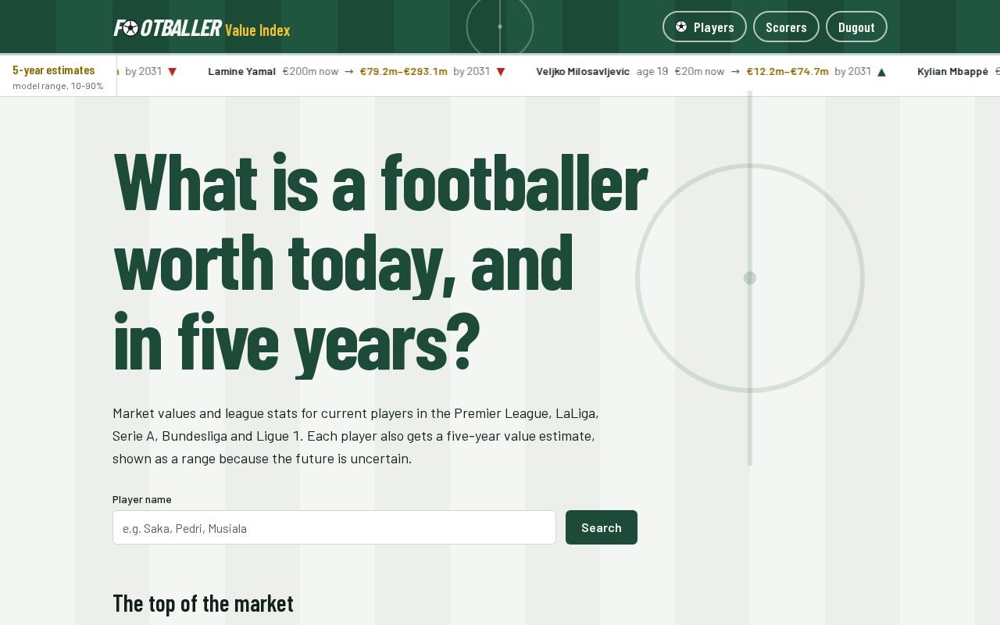
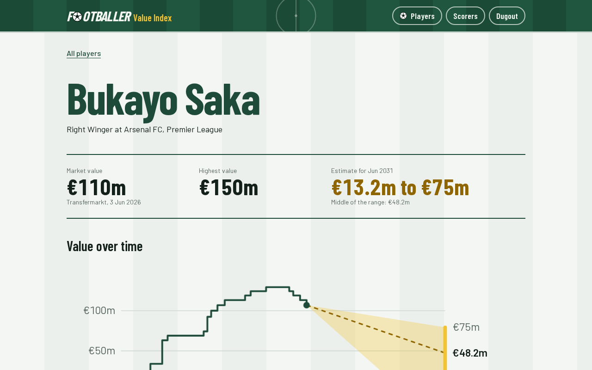
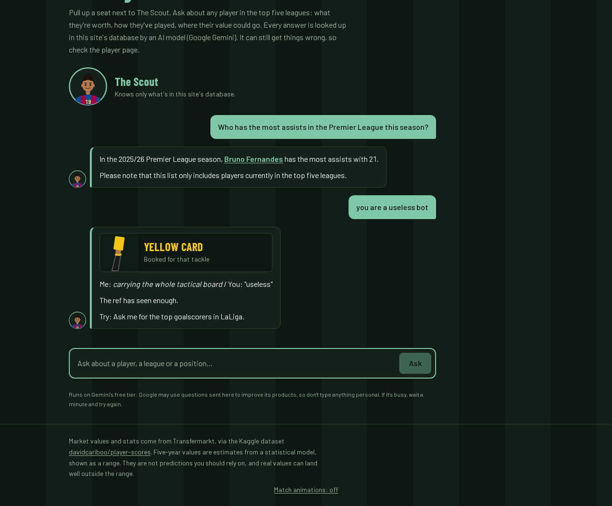
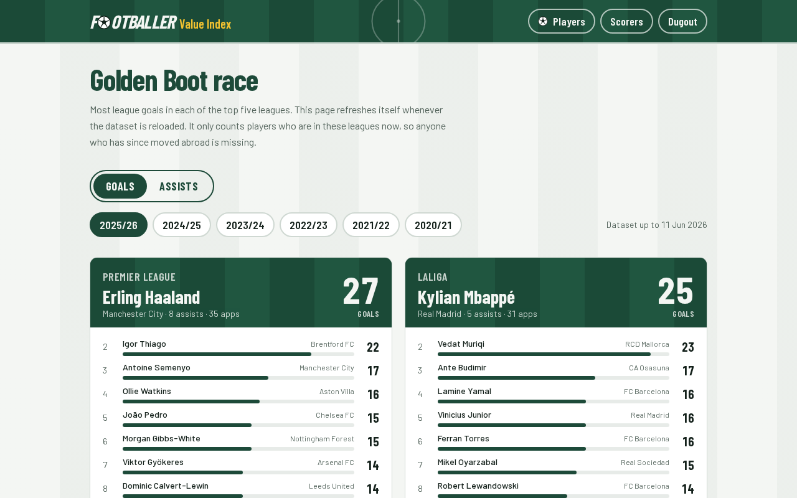
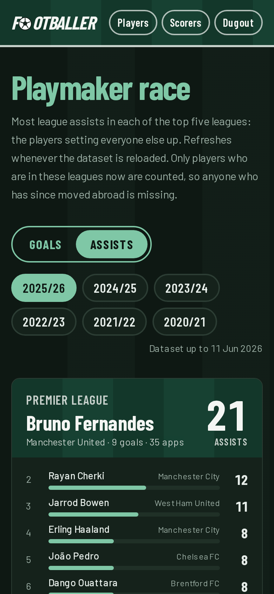
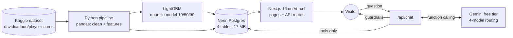

# Footballer Value Index

**What is a footballer worth today, and in five years?**

Market values, league stats and a **five-year value estimate** (shown as a range) for 3,012
current players in Europe's top five leagues, plus **The Scout**, an AI chatbot that answers
only from the site's own database.

**Live site: https://footballer-value-index.vercel.app**



| Player page | The Dugout (chatbot) |
|---|---|
|  |  |

| Golden Boot race | On a phone |
|---|---|
|  |  |

---

## What it does

- **Players**: search and filter 3,012 players in the Premier League, LaLiga, Serie A,
  Bundesliga and Ligue 1. Each player page shows current market value, highest value, value
  history, season stats and a 5-year estimate drawn as a widening band.
- **5-year estimates**: a LightGBM model gives a low / middle / high value (10th, 50th, 90th
  percentile). The site always shows the range and calls it an estimate, never a prediction.
- **Golden Boot and Playmaker races**: top 10 league scorers and assisters per league for the
  last six seasons.
- **The Scout (The Dugout)**: ask questions in plain English ("who has the most assists in
  Serie A?", "what's Pedri's 5-year estimate?"). Off-topic or trolling messages get a
  football-meme reply and an animated reaction card (yellow card, red card, VAR check,
  offside flag, fourth official's board).

## How it works



| Part | Tech | Notes |
|---|---|---|
| Data | Kaggle `davidcariboo/player-scores` | Market values from Transfermarkt. The only data source: no scraping |
| Pipeline | Python 3.12, pandas, pyarrow | `pipeline/`: download, profile, clean, features, train, check, load |
| Model | LightGBM 4.5 quantile regression | Predicts log(value in 5 years / value now) at the 10th, 50th and 90th percentile |
| Database | Postgres on Neon (free tier) | Players, valuations, season stats, projections. Read-only from the site |
| Web | Next.js 16 (App Router, TypeScript), Tailwind 4 | Cached server queries, CSS/SVG-only motion, dark mode, mobile-first |
| Chatbot | Gemini API (free tier), function calling | 4 read-only tools; the model never writes SQL |
| Hosting | Vercel Hobby | Auto-deploys from `main` |

**Total running cost: €0.** Free tiers only, no card on file anywhere.

## The model

- **Target**: the ratio between a player's value about 5 years after a date and their value on
  that date (log scale), learned from 81,896 historical valuations of 8,064 players
  (2013–2021). Features: age, position, foot, height, current and peak value, 1-year value
  change, and last season's league and per-90 stats, all using only data available on that
  date (no future leakage).
- **Validation**: trained on dates before 2020 and tested on 2020–21, so the test is a real
  "predict the future" check. The baseline is "the value stays the same".

| Metric (test set, 2020–21) | Model | Baseline |
|---|---|---|
| Error on the log ratio (MAE) | **0.836** | 1.485 (44% worse) |
| Median absolute % error | **62%** | 84% |
| Real value inside the 10–90% range | **77.6%** | (target 80%) |

- **Reading the results honestly**: a 62% median error means single numbers would be
  misleading, which is why the site only shows ranges. The middle estimate for the average
  current player is 0.43× today's value. That is mostly age: players over 27 typically lose
  value in five years, under-21s typically gain (see `docs/check_output.txt`).
- **Known bias**: players who retire or leave the data have no 5-year value, so they can't be
  in the training set. Estimates may lean optimistic.

## The chatbot, guardrails and evals

The Scout uses Gemini with **function calling**: the model can only call four read-only
lookups (search players, player details, rankings, league leaders). Every answer then goes
through guardrails before a visitor sees it:

- **Grounding check**: every € amount, goal/assist/appearance count, age and player link in
  the reply must match what the database returned for that question. If not, the model gets
  one automatic correction; if it still doesn't match, the visitor gets "I couldn't
  double-check that, so I won't guess".
- Swearing and instruction leaks are blocked; only player-page links are allowed; per-visitor
  rate limit to protect the shared free quota.
- **Model routing** across four free Gemini models with cool-downs, so one busy model doesn't
  take the chat down.

**Evals**: 29 test conversations (facts, estimates, made-up-data traps, prompt injection,
trolling, off-topic), scored with fixed rules against answers queried from the database at
run time. **Latest live run: 29/29 cases, 97/97 checks.**
Details: [docs/evals.md](docs/evals.md) · results: [docs/evals/chat-eval-latest.md](docs/evals/chat-eval-latest.md)

## Run it yourself

Needs Python 3.12, Node 24, a free [Neon](https://neon.tech) database, a free Kaggle API key
and a free [Gemini API key](https://aistudio.google.com). Secrets come from environment
variables only (`KAGGLE_USERNAME`, `KAGGLE_KEY`, `DATABASE_URL`, `GEMINI_API_KEY`).

```bash
# 1. Data pipeline and model
pip install -r pipeline/requirements.txt
python pipeline/download.py          # Kaggle dataset -> data/raw (git-ignored)
python pipeline/clean.py
python pipeline/features.py
python pipeline/train.py             # LightGBM quantile models
python pipeline/check_projections.py
python pipeline/load_db.py           # creates the tables and loads Neon (--replace to reload)

# 2. Website
cd web
npm ci
npm run dev                          # http://localhost:3000

# 3. Checks
npm run test:guard                   # guardrail unit tests
npm run build && npm start &         # then, in another terminal:
npm run eval:chat                    # chatbot eval suite
```

## Repo layout

```
pipeline/   Python data pipeline, model training, database loader
web/        Next.js app: pages, API routes, chatbot, guardrails, evals
docs/       Data notes (decisions and findings), eval write-up, screenshots
data/       Local data, git-ignored
```

The full decision log is in [docs/data-notes.md](docs/data-notes.md).

## Data and credits

Market values and stats come from **Transfermarkt**, via the Kaggle dataset
[davidcariboo/player-scores](https://www.kaggle.com/datasets/davidcariboo/player-scores).
Five-year values are statistical estimates shown as a range; they are not predictions to rely
on, and real values can land well outside the range. Only players currently in the top five
leagues are included.

Built by [zaarneshcodes](https://github.com/zaarneshcodes), with Claude Code as an AI pair programmer.
